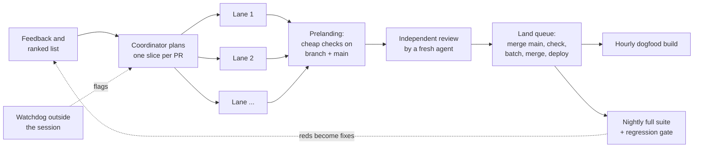

# The agentic coding loop

One person running a fleet of Claude Code agents to build and ship a real product:
an Android app and the plugin for the agent server it talks to. One coordinating
agent session plans and merges; up to five helper agents build in parallel, each in
its own worktree; hooks and scripts enforce the hard rules, so they hold even when
an agent forgets them.

This repository is the process behind that work, written down so it can be reused:
the protocol ([`LOOP.md`](LOOP.md)), the field notes it came from
([`docs/PARALLEL_LANES.md`](docs/PARALLEL_LANES.md)), and example hooks
([`hooks/`](hooks)). The product's code is private; everything
here is the part that generalizes.

Three words used below:

- **Round**: one agent, one question, one pull request. It reads a state file
  first, states what would prove it wrong, builds and checks, and writes the state
  file last, so the next memoryless session can pick up.
- **Lane**: one agent working one round at a time in its own branch and worktree.
  Several lanes run in parallel under one coordinator.
- **Roast**: an opt-in round where an agent uses the product as an impatient
  first-time user, and only complaints verified against the real product become work.

## Outcomes and scale

From the project's history, late September to mid November 2026 (about eight weeks):

| | |
|---|---|
| Pull requests merged | about 1,900; up to about 90 on a busy day |
| Agents at once | 1 coordinator + 2 to 5 helper lanes, including at most one bug lane and one process lane |
| Device tests | over 300 end-to-end scenarios on an emulator and real test phones |
| Unit tests | about 5,000 JVM tests, plus about 1,600 tests for the tooling itself |
| Enforcement | 16 Claude Code hooks; a merge queue that is the only way onto main |
| Releases | a dogfood build of main about hourly after fast checks; the full suite every night |
| Hardware | one 16 GB laptop, one build slot, a small device pool |

The numbers come from the project's own logs. One project and one author: read them
as a well-kept anecdote, not a benchmark.

## How work flows



- **Feedback** comes from the owner, from an in-app feedback loop, and from nightly
  reds. The owner keeps one ranked list; the coordinator takes its top ready row.
- **Lanes** each get one slice, one branch, one worktree, and a prompt that points at
  a single rules file. One lane per hotspot (a screen, the wire protocol), so lanes
  don't fight over the same lines.
- **Prelanding** runs the landing's own non-device checks on the branch merged with
  current main. The queue refuses a head with no recorded pass.
- **Independent review** is a fresh, read-only agent that never saw the author's
  session. For UI it compares every built state with the approved design.
- **The land queue** is the only merge path. It batches compatible PRs, bisects a red
  batch, and deploys main.
- **After merge**: short device checks in the background, a phone build about
  hourly, the whole suite at night. A bad build is fixed by shipping a newer one.

## Key ideas

### The human decides only what can't be undone

The owner's attention is the scarcest resource. Agents decide everything reversible
themselves: take the best recommendation, act on it, and log it in a short
"decided, not asked" list with how to reverse it. The owner reviews that list when
convenient; a reversal is ordinary work.

What still waits for the owner is a short written list: anything irreversible,
anything that spends money or acts in their name, loosening a safety gate, and the
priority order.

**Why:** one night the coordinator held every lane idle, waiting for a go-ahead on
calls it could have reversed in minutes. Nothing was gained by waiting.

### Hooks are the guardrails

Rules in a prompt are advice. Every rule that must hold with zero exceptions is a
pre-tool hook:

- no edits or git writes in the checkout the live service runs from;
- no device command outside the device lock;
- no agent spawn past the lane cap, onto a held hotspot, or without the rules pointer;
- no test message to any chat channel but the testing ones;
- no merge outside the queue, no stacked PRs, no bare `git stash`, no pattern kills.

Hooks guarding something irreversible fail closed on their own errors. A blocked call
says what to do instead, and a wrong block is fixed in the hook by PR, never worked
around.

**Why:** the coordinator once had about 18 agents running against a written limit of
five. The machine's load hit 51 and the service under test starved. The limit was in
its own notes; a hook ended it.

### Verification is independent and reads real sources

The author of a change never signs off on it. A fresh reviewer gets only the real
build output: for UI, a sheet with every state of every approved design beside the
screenshot of that state, in every theme. The gate refuses a PR whose reviewer is the
author, or whose screenshots changed after the review. No agent may stub, wrap or
feed a gate its own inputs.

**Why:** a release reached the owner's phone unlike its approved designs, with every
test green. On its first night the independent reviewer found real defects in nine
PRs that every test had passed.

### Resources are admitted, not cleaned up after

On one machine the limit is the slowest shared thing: memory, disk, the build slot,
the devices, the merge queue. Lanes are added by the queue's length, not by appetite,
and a new lane is refused below a disk floor or above a swap ceiling. One build at a
time. Cleanup still runs, as the backstop.

**Why:** in one day the disk hit zero (three landings died), swap filled, about 90
orphaned wait loops were found, some over a week old, and the laptop rebooted out of
memory. Each of those had a cleanup job; none had a gate.

### Every repeated failure becomes a mechanism

A daily blameless retro is compiled from local state. A slip seen twice in two weeks
becomes a hook, a queue refusal or a watchdog flag; a note in an agent's memory
doesn't count. Some of the stories behind the rules:

| what happened | what changed |
|---|---|
| The nightly skipped its device stage five nights running and read as green. | A stage that ran nothing is "not run", never green or red; a missing stage is an alarm. |
| An unattended job's login expired; every run failed for a week and nobody saw. | The watchdog reads each job's own output; a failure only the human can fix reaches them at once, with the one command to run. |
| Wait loops matched their own command line and never ended. | A hook refuses the self-matching form; a reaper kills old ones. |
| A bad "merge main" silently reverted another PR's work. | The queue refuses a PR missing lines main added to a file it also changes. |
| About 2 of 15 fixes written for nightly reds were real bugs. | One targeted retry before a red counts; quarantine with an owner after two. |
| The watchdog was installed with a trigger that fired once. | It stamps every run; a stale stamp is itself an alarm. |

More, with numbers: [`docs/PARALLEL_LANES.md`](docs/PARALLEL_LANES.md).

## One round, end to end

From a benchmark project that runs the single-agent loop. Its README claimed that
matched pairs of test scenarios stop a model from winning by keyword matching. It
had never been measured. The state file's queue before round 1 (abridged):

```markdown
## Queue — next rounds
1. Does the matched-pair design actually prevent surface pattern matching,
   or is that just a claim in the README?
```

The round wrote down its falsifier first (a bag-of-words probe should sit near the
50% floor), built the probe, and ran it on the unchanged code. The state file after (abridged):

```markdown
## Round 1 — shortcut resistance
Finding: the claim was false. The probe hit 93.5% (floor 50%).
Each side of a pair had its own phrasing, so single words gave the answer away.
Fix: both sides share an identical body; one signal swaps roles. Probe: 57.5%.
Also found: one scenario variant had inverted labels since the first commit.
Ending state: shipped. Probe kept as a CLI command and five invariant tests.
```

The pull request carried the probe, the rebuilt generator, the corrected README,
and a reference heuristic whose score fell to chance, because its old score had been
leakage. Every round of that project, including the costs:
[`docs/CASE_STUDY.md`](docs/CASE_STUDY.md).

## The protocol, as a plugin

The general part is packaged as a Claude Code plugin: one agent improving a codebase
across weeks of memoryless sessions, scaling to parallel lanes.

```
/plugin marketplace add max-friedman/agentic-coding-loop
/plugin install loop@agentic-coding-loop
```

| skill | what it does |
|---|---|
| `loop-init` | Bootstrap the state file from the real project. |
| `loop-run` | Repeated rounds until a stop condition fires. |
| `loop-round` | Exactly one round. |
| `loop-audit` | Measure whether the project's strongest claim still holds. |
| `loop-roast` | Opt-in: critique the product as a first-time user. |
| `loop-feedback` | File a proposal upstream about the protocol. |
| `loop-lanes` | Opt-in: coordinate several agents running rounds in parallel. |

Any agent, any harness: [`LOOP.md`](LOOP.md) is self-contained, one fetch.

**How the protocol changes.** A project's finding comes back as an issue with
evidence. A scheduled reviewer agent judges it against a reject-by-default rubric.
So far 14 proposals were judged: 5 accepted, 9 rejected, each with its reasons on the
issue ([`CONTRIBUTING.md`](CONTRIBUTING.md)).

**This repo merges its own round PRs after 24 hours.** That is a choice for a
one-person repo, not a recommendation. The safeguards: a round never merges its own
work; the 24 hours are the owner's veto window; anything touching the review
machinery, the rubric, code owners, the license or repo settings always waits for the
owner; and a change reaches other projects only through a versioned release. On a
team repo I would require a human review instead.

## For the Claude Code team

The product gaps I hit most, each as user problem, evidence, and what I'd change.

| problem | evidence | what I'd change |
|---|---|---|
| A scheduled Routine reports SUCCEEDED while doing nothing. | All three of this repo's Routines ran on schedule for days, 17 to 63 seconds each, and did nothing: scheduled sessions started with no repository attached. An open issue tracks another empty "success". | Fail a run that never touched its repository, and show what a run produced next to its status. |
| `git stash` is shared by every worktree. | With several sessions in worktrees, one session's `stash pop` can take another's work. I block bare stash with a hook. | Warn on stash in a worktree session, or set work aside per session by default. |
| No native cap on spawned agents. | About 18 agents ran against a written limit of 5; load hit 51 and the service under test starved. Only a hook stopped it. | A per-project limit on concurrent subagents, with resource floors, set in settings. |
| A background task can end the agent's turn for good. | A helper backgrounded its landing and ended its turn; it never came back and the PR sat as a draft. | Keep a subagent alive, or wake it, until the background tasks it started finish. |
| Compaction and context hand-offs lose the thread. | Helpers ran out of context mid-chain twice in one night; the coordinator needs a written rebuild procedure after every compaction. | A first-class hand-off: the agent names the state file it resumes from, and the harness checks it exists before compacting. |
| `pgrep -f` wait loops match their own shell. | Bash calls run as `zsh -c '<command>'`; about 90 wait loops never ended, some over a week old. | Notify on process exit natively, or warn on this loop shape. |
| An expired CLI login fails silently in unattended runs. | An unattended loop failed to authenticate on every run for a week before anyone noticed. | Treat an auth failure in a non-interactive run as a loud, distinct exit, and surface it to the account owner. |

## Where to look

| | |
|---|---|
| [`LOOP.md`](LOOP.md) | The protocol: round steps, hard rules, parallel lanes, goal loops. |
| [`docs/PARALLEL_LANES.md`](docs/PARALLEL_LANES.md) | Field notes from the multi-agent project: the top lessons, each with its incident. |
| [`hooks/`](hooks) | Tested, generic hooks and an example settings file. |
| [`docs/PRINCIPLES.md`](docs/PRINCIPLES.md) | Why each rule exists and the failure it prevents. |
| [`docs/CASE_STUDY.md`](docs/CASE_STUDY.md) | Every round of the single-agent loop on a benchmark, including what it cost. |
| [`CHANGELOG.md`](CHANGELOG.md) | What changed in the process, release by release, and why. |

## How this maps to a team

The roles are familiar ones. Agents just make the costs show up faster.

- **The coordinator is a tech lead and release manager.** It picks work from a ranked
  list, sizes the team to what can be merged, reviews, and is the one voice to the
  stakeholder.
- **Lanes are engineers on disjoint areas.** Hotspots are code ownership. "Finish
  before starting" is a WIP limit.
- **Prelanding and the land queue are CI and a merge queue**, shifted left so most
  failures happen before a PR waits in line.
- **Independent review is code review and design QA** by someone who didn't write the
  change, against the spec, not the author's explanation.
- **"Decided, not asked" is a decision log.** Unblock yourself, make the call
  visible, keep it reversible.
- **Retros that end in a mechanism are blameless postmortems** whose action items
  actually close.

The main lesson carries over: writing code got cheap; landing it safely didn't. Most
of this process exists to keep the path onto main fast and honest.

## Limits, and what would prove it works for others

Everything here comes from one person. The app project, the benchmark and an earlier
production app all trace back to me, and no independent team has run this process.
The multi-agent rules were written from one project's logs, not reviewed through the
proposal process, and no other project has run them as released. Goal loops are
newer still: the first one was parked within hours when the machine ran out of
memory, so there is no result yet. Cost figures mix several changes made at once, so
no single rule can claim them.

To know it works for someone else, I would measure, on a second team's project:

- **Merged PRs per day and lead time** from first commit to merge, before and after
  adopting the lanes and the land queue.
- **Escaped defects**: bugs found after merge per 100 PRs, and how many the
  independent review caught first.
- **Owner interruptions per day**, and how many "decided, not asked" calls the owner
  reversed. A high reversal rate means the line is in the wrong place.
- **Idle and wasted time**: lanes waiting, landings failed on environment, runs that
  ran nothing.
- **Hook blocks per week**, and how many were wrong blocks.

## License

MIT. Use it, fork it, strip the parts you disagree with.
