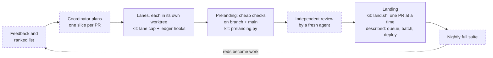

# The agentic coding loop

One person running a fleet of Claude Code agents to build and ship a real product:
an Android app and the plugin for the agent server it talks to. One coordinator
session plans and merges. Up to five helper agents build in parallel, each in its own
worktree. Hooks enforce the hard rules, so they hold even when an agent forgets them.

This repo is that process, written down to reuse. The product's code is private.

## Start here (5 minutes)

1. **The problems:** [the gap brief](docs/FOR_CLAUDE_CODE_TEAM.md), five product gaps with evidence (top three below).
2. **Try the small version:** [`docs/STARTER.md`](docs/STARTER.md), a state file and three hooks. No installer.
3. **Or the whole kit:** `python3 scripts/bootstrap_kit.py <your-repo> --dry-run` shows what would change; run it
   without `--dry-run` (add `--test` to run the hook tests). It merges into an existing `.claude/settings.json` (backup
   kept), never overwrites `CLAUDE.md`, and keeps two opinionated hooks off until `.loop/config.json` turns them on:
   the `gh pr merge` block (`gh_rules.block_pr_merge`) and the coordinator Stop hook (`coordinator.require_checks`).
   `admission_gate` is on: it blocks a spawn under 15 GB free disk (`resources.min_free_disk_gb`, lowered on a small
   disk). Knobs: [`hooks/README.md`](hooks/README.md). The `loop-init` skill runs the same installer.

**Words used here.** A *round* is one agent answering one question in one pull
request: it reads a state file first and writes it last, so the next memoryless
session can continue. A *lane* is one agent running rounds in its own branch and
worktree, beside others. The *coordinator* is the session that starts lanes, reviews
their work and merges it.

## For the Claude Code team

The three gaps that cost me most, ranked by a guess at reach × severity
([all five, with evidence](docs/FOR_CLAUDE_CODE_TEAM.md)):

1. **Unattended runs report success when they did nothing.** This repo's round
   Routine recorded SUCCEEDED five times with no output: its sessions had no MCP
   tools, so it couldn't attach the repo
   ([#37](https://github.com/max-friedman/agentic-coding-loop/issues/37)). Separately,
   an expired CLI login failed every run for a week, unseen. *Likely affects anyone
   running Routines, cron or CI jobs.*
2. **No built-in limit on concurrent agents or their resources.** About 18 agents ran
   against a written limit of 5 and starved the machine; later the disk hit zero with
   the cap respected. *Affects anyone running parallel agents on one machine.*
3. **Parallel sessions collide on shared state.** About 90 `pgrep -f` wait loops
   matched their own shell and never ended; `git stash` is one stack for every
   worktree. *Affects anyone running several sessions at once.*

## Outcomes and scale

About eight weeks, late September to mid November 2026. These numbers come from the private app project's own history; what's published here is the process, its generic hooks and a starter kit, not that project's code.

| | |
|---|---|
| Pull requests merged | about 1,900; up to about 90 on a busy day |
| Agents at once | 1 coordinator + 2 to 5 lanes |
| Device tests | over 300 end-to-end scenarios on an emulator and real test phones |
| Unit tests | about 5,000 JVM tests, plus about 1,600 tests for the tooling |
| Enforcement | 16 hooks in the private project, one merge queue the only way onto main; 10 hooks ship here (plus a watchdog script) |
| Releases | a test build of main about hourly; the full suite every night |
| Hardware | one 16 GB laptop, one build slot, a few test devices |
| Cost per merged change | 400–700k tokens with four feature lanes, 215–325k with two after shared files were split; three changes landed together, so no single one owns the drop |

## How work flows

Solid boxes: the kit ships a hook or script. Dashed: described in the docs only.

## Three ideas

**The human decides only what can't be undone.** Agents make every reversible call
themselves, act on it, and log it with how to reverse it. The owner reviews the log
in one pass. *Why:* one night the coordinator held every lane idle, waiting on calls
it could have undone in minutes.

**Hooks are the guardrails.** Every rule that must hold without exception is a hook:
no edits in the live checkout, no device use outside its lock, no spawn past the cap,
no merge outside the queue. A blocked call says what to do instead. *Why:* the agent
that started 18 agents had the limit of 5 in its own notes.

**The author never signs off.** A fresh reviewer that never saw the author's session
compares the real build with the approved design, state by state. *Why:* a release
reached the owner unlike its designs with every test green; the reviewer's first
night found real defects in nine PRs.

## Who this is for

- **For** people running two or more coding agents on one codebase, or one agent
  across many sessions, who need the work to compound instead of drift.
- **Not for** a single quick session, or a team that already has CI, a merge queue
  and code review and runs one agent at a time. You have most of this already.

## Status

- **Last round:** Round 4, run by hand on 2026-11-18 ([state file](docs/plans/LOOP_STATE.md)).
  Scheduled rounds are paused with no restart date: the Routine's sessions had no
  tools to attach the repo, so it recorded SUCCEEDED and did nothing (#37).
- **Nothing merges itself.** The owner reviews and merges every PR; the 24-hour
  self-merge described in [`CONTRIBUTING.md`](CONTRIBUTING.md) is off.
- **Versions.** 0.14 to 1.2 shipped in one evening, 2026-11-18, while the public repo
  caught up with two months of private practice; 1.0 because renaming `NEEDS-MAX` to
  `NEEDS-OWNER` breaks existing state files ([`CHANGELOG.md`](CHANGELOG.md)).
- **Wanted: one outside user.** Try the starter or the kit, then [open a proposal issue](https://github.com/max-friedman/agentic-coding-loop/issues/new?template=loop-proposal.yml) with what you ran, what broke and what you'd change.
- **One author.** Nobody else has run this yet. [`docs/ON_A_TEAM.md`](docs/ON_A_TEAM.md)
  says what I'd measure to find out, and how I'd find a first outside user.

## Deep dive

| | |
|---|---|
| [`docs/FOR_CLAUDE_CODE_TEAM.md`](docs/FOR_CLAUDE_CODE_TEAM.md) | The five product gaps, with evidence. |
| [`docs/STARTER.md`](docs/STARTER.md) | The 20% version: a state file and three hooks. |
| [`hooks/`](hooks) | The tested, generic hooks and their knobs; the kit installs them. |
| [`docs/PARALLEL_LANES.md`](docs/PARALLEL_LANES.md) | The top ten lessons from the multi-agent project, each with its incident. |
| [`docs/WALKTHROUGH.md`](docs/WALKTHROUGH.md) | One round end to end: the state file before, the finding, the PR. |
| [`docs/ON_A_TEAM.md`](docs/ON_A_TEAM.md) | How this maps to a team, what to measure, a first outside user. |
| [`LOOP.md`](LOOP.md) | The full protocol, written for agents. |
| [`docs/ADOPTING.md`](docs/ADOPTING.md) | Installing it as a Claude Code plugin, and its skills. |
| [`CHANGELOG.md`](CHANGELOG.md) | What changed, release by release, and why. |

## License

MIT. Use it, fork it, strip the parts you disagree with.
